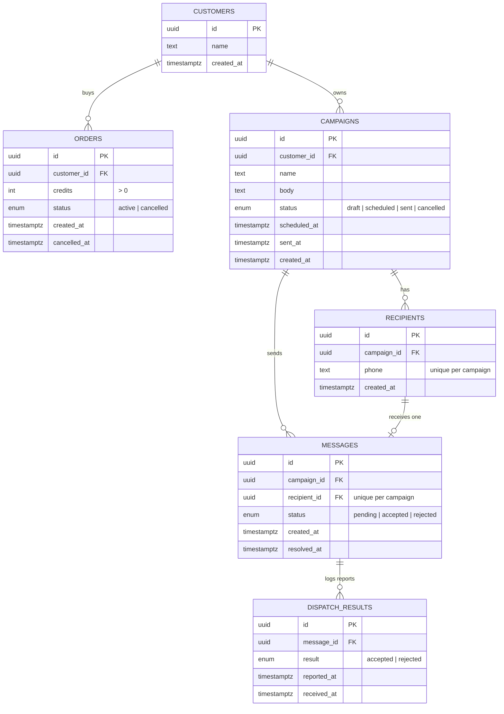

# Message Credits Core

The credit-accounting core for a prepaid SMS platform. Customers buy credit in orders, spend it on scheduled campaigns, and see a clear balance on their dashboard.

This is the domain core only. The HTTP API, UI, dispatcher and notifications are out of scope, per the brief. The services are plain NestJS providers that an API or worker would call.

The design choices and their reasons are in [DECISIONS.md](DECISIONS.md).

## Stack

NestJS · TypeORM (entities + migrations) · PostgreSQL 16 · Jest (tests run against a real database)

## Setup

All commands run inside `backend/`.

**1. Start Postgres**

```bash
docker run -d --name credits-db \
  -e POSTGRES_USER=myuser -e POSTGRES_PASSWORD=mypassword -e POSTGRES_DB=mydbname \
  -p 5432:5432 postgres:16
docker exec -it credits-db createdb -U myuser mydbname_test
```

**2. Configure**

```bash
cp .env.example .env            # app database
cp .env.test.example .env.test  # test database
npm install
```

The connection is set with `DB_HOST`, `DB_PORT`, `DB_USER`, `DB_PASSWORD`, `DB_NAME`. To point the tests at another database, change `.env.test`.

**3. Create the schema**

```bash
npm run migration:run
```

## Run the tests

```bash
npm test
```

Jest runs the migrations on the test database first, clears the tables before each test, and runs the suites one at a time (`--runInBand`), because they share one database.

## Code map

```
backend/src/
  database/
    entities/        Customer, Order, Campaign, Recipient, Message, DispatchResult + status enums
    migrations/      Initial schema (generated by TypeORM)
    data-source.ts   Config for the TypeORM CLI
  common/
    lock-customer.ts              Row lock (SELECT … FOR UPDATE) every credit change takes first
    calculate-credit-breakdown.ts The one balance formula: purchased / reserved / in flight / spent / available
    calculate-available-credit.ts Available credit, used by schedule and add-recipients checks
    errors/                       Domain errors, each with a code
  orders/       PlaceOrderService, CancelOrderService
  campaigns/    CreateCampaignService, AddRecipientsService, RemoveRecipientsService,
                ScheduleCampaignService, CancelScheduleService
  sending/      SendDueCampaignsService, RecordDispatchResultService
  balance/      GetCustomerBalanceService
backend/test/
  jest-global-setup.js  Runs migrations before the tests
  utils/                Test helpers (reset DB, create customer)
```

## How it works

- **Balance is calculated, not stored:** available = active orders − reserved − in flight − spent.
- **Credit is held at scheduling.** If there isn't enough, scheduling is refused right away.
- **Sending** creates one `pending` message per recipient. The dispatcher (not part of this repo) delivers them and reports back.
- **Results:** accepted = charged, rejected = free. Accepted is final.
- **Concurrency:** locks always follow the order customer → campaign → message. `SKIP LOCKED` lets several workers send at once without sending a campaign twice.

## Entity-relationship diagram



## Out of scope

HTTP API, UI, authentication, the dispatcher and delivery provider, notifications, and the cron that calls `SendDueCampaignsService` in production.
